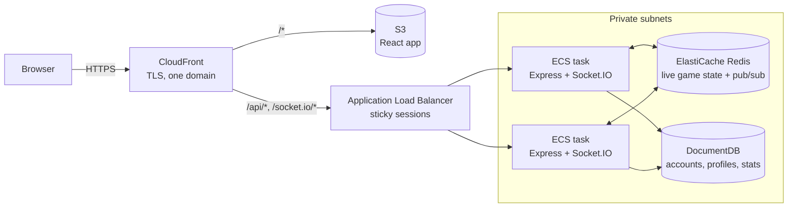
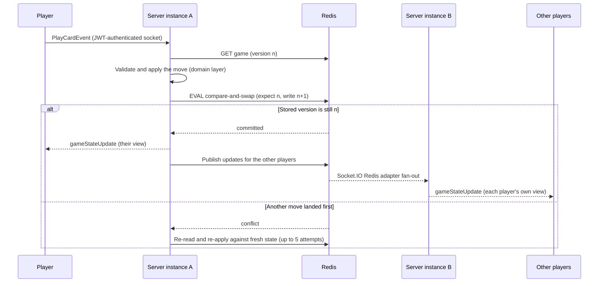

# Pitch

[](https://github.com/Caleb-Kelly-25/pitch/actions/workflows/ci.yml)

A real-time multiplayer version of the card game Pitch. The server owns the game state and enforces the rules, the backend scales horizontally on AWS, and every action is applied safely when several arrive at once. Built by team JACC'd (Jordan, Amber, Caleb, Charlie).

## Highlights

- **The server owns the game.** Clients send intents ("play this card"), never state. The server checks every move against the rules and sends each player a separate view that includes only their own hand.
- **Stateless servers that scale horizontally.** Node.js instances on ECS Fargate run behind a load balancer, and Socket.IO messages reach players on other instances over Redis pub/sub.
- **Optimistic concurrency.** Each game carries a version number, and a Redis Lua script performs an atomic compare-and-swap. Moves that arrive at the same time are never lost or applied twice.
- **Hexagonal architecture.** The game rules don't depend on Express, Socket.IO, Redis, or MongoDB.
- **187 automated tests.** They cover the domain, the use cases, the storage adapters against real Redis and MongoDB, and a full four-player game played over real sockets. CI runs them on every pull request.
- **Infrastructure as code.** The whole AWS stack is defined in Terraform. App servers and data stores sit in private subnets, and each tier accepts traffic only from the tier in front of it.

---

## Architecture



### Life of a move



---

## Design Decisions

### Server-authoritative state with per-player views

Clients emit intents such as `PlayCardEvent` over an authenticated socket. The domain layer checks turn order, the current phase, and the trump rules before anything changes. After each move, the server builds a separate view for each player: their own cards, plus only a card count for everyone else. Hidden information never leaves the server, so a modified client can't see other players' hands or make an illegal move.

### Hot and cold storage

| | Redis (hot) | DocumentDB (cold) |
|---|---|---|
| Holds | Live game state | Accounts, profiles, lifetime stats |
| Access pattern | Read and rewritten on every move | Read at login and on profile views, written as tricks complete |
| Lifetime | 1-hour TTL, refreshed on every write | Permanent |

Live games are short-lived and change constantly, so they live in memory. A 1-hour TTL, refreshed on every write, lets abandoned games clean themselves up. Data that must survive lives in DocumentDB, which is MongoDB-compatible. **Trade-off:** games in progress are not durable, so losing the Redis node ends them. That's acceptable because games last minutes, while anything a player would miss, like their account and stats, is stored durably.

### Optimistic concurrency instead of locks

**Problem:** two actions can hit the same game at once. A bot's move can race a human's, a player can double-click, or two server instances can each handle a request. With a naive read-modify-write, one of those updates silently overwrites the other.

**Solution:** every game state carries a `version`. Each transition runs through [`withGameState`](server/src/application/CasTransaction.ts):

1. Read the game and note its version.
2. Apply the move to that fresh copy.
3. Commit only if the stored version is unchanged. A Lua script does the check and the write in one step, and Redis runs scripts one at a time, so nothing can slip in between.
4. On a conflict, re-read and apply the move again to the new state. It never resubmits the stale result. After 5 attempts it gives up, and the client receives `ActionRejectedEvent` with `retryable: true`.

Side effects such as recording player stats run only after a successful commit, so an attempt that lost the race never counts.

**Why not a lock?** Only one player acts at a time in a card game, so conflicts are rare and a retry is cheap. A correct distributed lock also needs lease expiry and fencing tokens to stay safe when the lock holder stalls. Compare-and-swap is correct without either.

### Scaling WebSockets horizontally

No game state is kept in a server's memory, so any instance can handle any action. Running more than one instance raises two problems:

1. **Players in the same game may connect to different instances.** The Socket.IO Redis adapter relays each message over Redis pub/sub to the instance that holds the recipient's connection.
2. **Socket.IO opens with HTTP long-polling before upgrading to WebSocket,** and those requests must reach the same instance. The load balancer uses sticky sessions (`lb_cookie`) to guarantee that.

ECS scales on CPU (70% target), capped at 2 tasks for cost.

### Hexagonal architecture (ports and adapters)

```
domain/       Game rules: entities, hand phases, errors. Pure TypeScript, no I/O.
application/  Use cases (PlaceBid, PlayCard, RoomService, ...). Talk only to ports.
ports/        Interfaces: short-term storage, long-term storage, game publisher.
adapters/     Redis, MongoDB, Socket.IO, Express REST, JWT auth.
```

The use cases depend on interfaces, not infrastructure. As a result, the domain and application tests run against in-memory adapters in milliseconds. The in-memory storage adapter also serializes state the same way Redis does, so the tests catch bugs where callers share a mutable object.

### One origin through CloudFront

CloudFront serves the React app from a private S3 bucket and routes `/api/*` and `/socket.io/*` to the load balancer. TLS ends at CloudFront with an ACM certificate. Because the whole app is on one domain, production needs no cross-origin (CORS) setup.

### Network isolation and secrets

The ECS tasks, Redis, and DocumentDB run in private subnets. Security groups chain from tier to tier: the load balancer accepts public traffic, the tasks accept traffic only from the load balancer, and Redis and DocumentDB accept traffic only from the tasks. DocumentDB connections use TLS. Secrets (`MONGO_URI`, `JWT_SECRET`) are stored in SSM Parameter Store and injected into each task when it starts.

---

## Failure Modes

| Event | What happens |
|---|---|
| A server instance dies | The load balancer's health check (`/api/health`) removes it. Socket.IO clients reconnect automatically to a healthy instance. Game state lives in Redis, so the game continues, and rejoining with the game code resends the current state. |
| Two moves arrive at once | Compare-and-swap commits one. The other is reapplied to the new state, or rejected if it's no longer legal (for example, "not your turn"). |
| A player double-clicks Join | The seat check runs inside the transaction, so the player is seated once. |
| Two players race for the last seat | Exactly one is seated. The other gets "Room is full." |
| A game is abandoned | Its Redis key expires 1 hour after the last move. |
| Redis restarts | Games in progress are lost. Accounts and stats in DocumentDB are unaffected. |

---

## Testing

| Layer | Tests | What they cover |
|---|---|---|
| Domain | 44 | Cards, tricks, bidding cycle, hand phases, scoring |
| Application | 79 | Use cases and concurrency: retries, conflicts, join races |
| Adapters | 25 | REST controllers, WebSocket handlers, auth, persistence |
| Integration | 39 | Storage adapters against real Redis and MongoDB (including concurrent compare-and-swap writers), Socket.IO round trips, and a full 4-player game from registration to completion |

```bash
cd server
npm test
```

The integration tests start their own throwaway Redis and MongoDB servers (`redis-memory-server`, `mongodb-memory-server`), so they need no Docker or running services. CI runs the type check and the full suite on every push and pull request.

---

## Known Limitations and Next Steps

- **Bot turns are scheduled with an in-process `setTimeout`.** If that instance dies, the bot never moves and the game stalls. *Next:* store the bot's deadline in Redis and let any instance pick up overdue turns. Compare-and-swap already makes it safe for two instances to try the same turn.
- **Redis is a single node.** It's a single point of failure for live games. *Next:* a replication group with automatic failover.
- **`getAllGameStates` uses `KEYS *`.** That command blocks Redis while it scans the whole keyspace. *Next:* use `SCAN`, or keep a set of active game IDs.
- **The load balancer can be reached directly.** CloudFront sends an `X-Origin-Verify` header, but the load balancer doesn't check it yet. *Next:* add a listener rule that rejects requests without the header.
- **Observability is logs only.** *Next:* metrics for the conflict rate and per-action latency.

---

## Tech Stack

| Layer | Technology |
|---|---|
| Frontend | React 19, TypeScript, Vite, Redux Toolkit, Socket.IO client |
| Backend | Node.js 20, Express 5, TypeScript, Socket.IO |
| Hot storage | Redis (live game state, Socket.IO pub/sub) |
| Cold storage | MongoDB locally, AWS DocumentDB in production |
| Infrastructure | AWS ECS Fargate, ALB, ElastiCache, DocumentDB, S3, CloudFront, Route 53 |
| Infrastructure as code | Terraform |
| CI/CD | GitHub Actions (tests on every PR, manual deploy workflows) |

---

## Running Locally

**Prerequisites:** [Docker Desktop](https://www.docker.com/products/docker-desktop/) and Node.js 20+.

```bash
git clone https://github.com/Caleb-Kelly-25/pitch.git
cd pitch
cp server/.env.example server/.env
cp client/.env.example client/.env

docker compose up --build        # backend :3000, Redis :6379, MongoDB :27017

# in a second terminal
cd client
npm install
npm run dev                      # http://localhost:5173
```

Open [http://localhost:5173/signup](http://localhost:5173/signup) and create an account. To play a full game, host a game and join from three more browser tabs or browsers using the game code, or fill empty seats with bots from the lobby.

To deploy to AWS, see [docs/deployment.md](docs/deployment.md).

---

## Project Structure

```
pitch/
├── client/                  React frontend (Vite + TypeScript)
│   └── src/
│       ├── app/             Redux store and router
│       ├── components/      Reusable UI components
│       ├── features/        auth, game, and profile slices and hooks
│       ├── pages/           Login, Signup, Host, JoinGame, GamePlay, Leaderboard, ...
│       └── lib/             Socket.IO connection
├── server/                  Node.js backend (Express + Socket.IO)
│   └── src/
│       ├── domain/          Game rules: entities, enums, errors
│       ├── application/     Use cases and the compare-and-swap transaction helper
│       ├── ports/           Interfaces the application layer depends on
│       ├── adapters/        Redis, MongoDB, Socket.IO, REST, JWT
│       └── tests/           Domain, application, adapter, and integration tests
├── infrastructure/
│   └── terraform/           The full AWS stack
├── docs/                    Deployment guide and course requirements scope
├── docker-compose.yml       Local backend, Redis, and MongoDB
└── .github/workflows/       CI and deploy pipelines
```

This started as a course project; [docs/course-requirements.md](docs/course-requirements.md) records how the delivered scope compares with the original requirements.
